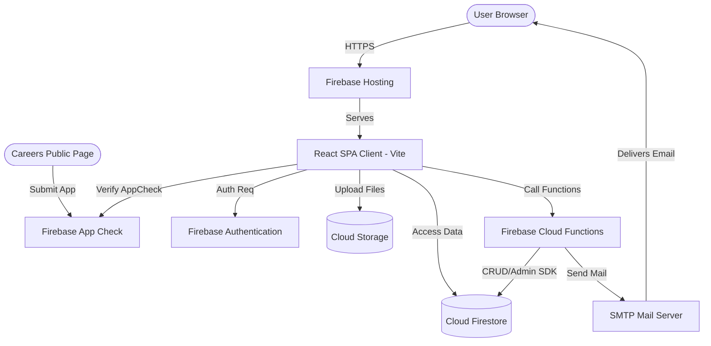
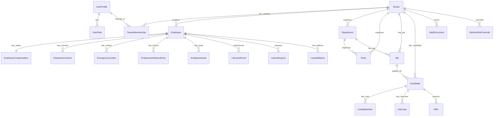
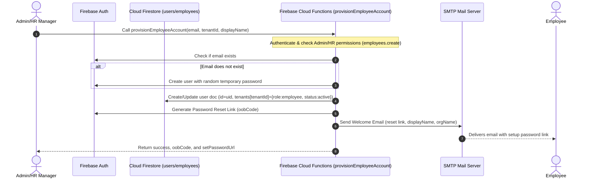
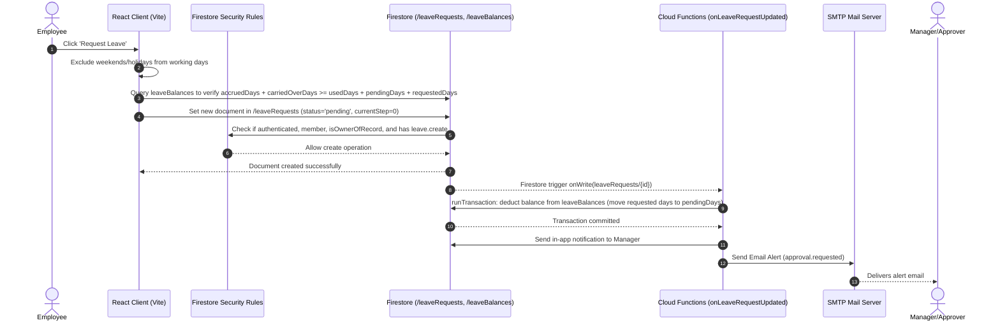
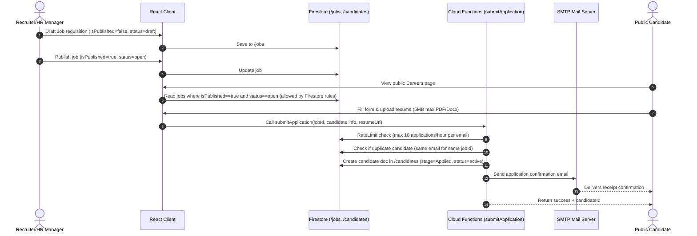
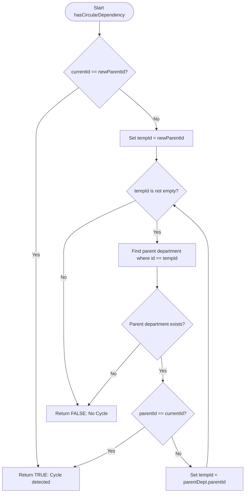
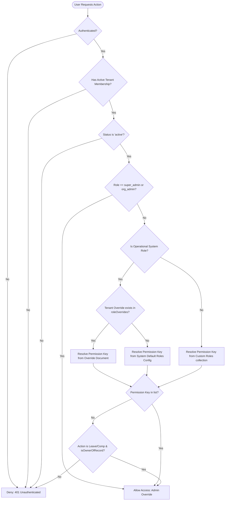

# Enterprise HRMS & ATS SaaS Platform: Complete Technical Specification

This document provides a comprehensive technical blueprint, workflow specification, and operational guide for the Human Resource Management System (HRMS) & Applicant Tracking System (ATS) SaaS Platform. It is structured to serve as a single source of truth for clients, investors, developers, QA teams, and administrators.

---

## Document Information
| Attribute | Detail |
| :--- | :--- |
| **Document Version** | 1.0.0 (Enterprise Gold Release) |
| **Target Audience** | Technical Stakeholders, Investors, Developers, QA, System Admins, Auditors |
| **Monorepo Workspace Root** | [hrms-ats-saas](file:///D:/Projects/hrms-ats-saas) |
| **Last Updated** | June 2026 |
| **Security Classification** | Proprietary & Restricted |

---

## 📖 Table of Contents
1. [Executive Summary & Project Overview](#1-executive-summary--project-overview)
2. [Product Vision, Goals, and Objectives](#2-product-vision-goals-and-objectives)
3. [Core Key Features](#3-core-key-features)
4. [Technology Stack & Justification](#4-technology-stack--justification)
5. [System Architecture](#5-system-architecture)
6. [Database Architecture (Firestore Collections)](#6-database-architecture-firestore-collections)
7. [API & Event Trigger Documentation](#7-api--event-trigger-documentation)
8. [End-to-End Business Processes & Workflows](#8-end-to-end-business-processes--workflows)
9. [UML & Sequence Diagrams](#9-uml--sequence-diagrams)
10. [Folder & Directory Structure](#10-folder--directory-structure)
11. [Installation & Setup Guide](#11-installation--setup-guide)
12. [Environment Variables Reference](#12-environment-variables-reference)
13. [Testing & QA Strategy](#13-testing--qa-strategy)
14. [Deployment Architecture & CI/CD Flow](#14-deployment-architecture--cicd-flow)
15. [Security & Compliance Architecture](#15-security--compliance-architecture)
16. [Operations & Administration Manual](#16-operations--administration-manual)
17. [Troubleshooting & FAQs](#17-troubleshooting--faqs)
18. [Known Limitations & Product Roadmap](#18-known-limitations--product-roadmap)
19. [Conclusion](#19-conclusion)

---

## 1. Executive Summary & Project Overview

### 1.1 Problem Statement
Modern enterprises struggle with fragmented employee lifecycle management. Human resources records, leave tracking, document storage, and applicant hiring tracking often exist in siloed software suites. This fragmentation leads to:
* **Security & Compliance Risks:** Sensitive financial data (e.g., salaries) is often stored in unsecured spreadsheets or systems without granular row-level protection.
* **Operational Inefficiencies:** Slow approvals for hire requisitions and time-off requests, which block growth.
* **Poor Data Segregation:** Multi-tenant systems frequently fail to guarantee complete data isolation, creating risks of cross-tenant data leaks.
* **High Maintenance Costs:** Integrating disjointed ATS and HRMS tools incurs heavy license and consulting fees.

### 1.2 Existing System Challenges
Legacy HR tools lack modern UX standards and fail to support customization at the tenant level. For example, role permission definitions are hardcoded, preventing an organization from adjusting recruiter or employee permissions without vendor customization. Furthermore, hierarchical systems (like departments) often suffer from structural errors like circular dependency loops (e.g., Department A reporting to Department B, which reports to Department A), crashing reporting lines.

### 1.3 Proposed Solution
The **Enterprise HRMS & ATS SaaS Platform** is a unified, multi-tenant monorepo workspace. It integrates administrative HR capabilities with a complete Applicant Tracking System. By combining structural data isolation, customized role-based access controls, automated leave settlement algorithms, and recursive safety checks (such as DFS-based circular dependency prevention), it offers a reliable, low-latency, secure platform inspired by modern standards like HiBob and Rippling.

---

## 2. Product Vision, Goals, and Objectives

### 2.1 Project Vision
To deliver a high-performance, secure, and visually outstanding HRMS & ATS SaaS platform that guarantees multi-tenant isolation, offers custom role matrices, and reduces operational overhead for HR, recruiters, and managers.

### 2.2 Goals & Objectives
* **Zero Cross-Tenant Leaks:** Absolute isolation at the database (Firestore) and file levels.
* **Granular Autonomy:** Enable tenant administrators to override default system permission matrices (for HR Managers, Recruiters, and Employees) dynamically.
* **Algorithmic Safety:** Guarantee transactional balance operations on leave accruals to prevent "double-spending" of time-off. Prevent circular department hierarchies using topological cycles check.
* **Public/Private API Segregation:** Secure administrative actions with authentication and Firebase App Check, while offering optimized, rate-limited public APIs for application submissions.

---

## 3. Core Key Features

* **Multi-Tenant Segregation:** Isolated organization workspaces (`/tenants`) at the database and storage level.
* **Dynamic RBAC & Scoped Access:** Granular roles (`super_admin`, `org_admin`, `hr_manager`, `recruiter`, `employee`) mapping to permissions, with data scoping levels (`self`, `team`, `department`, `all`). Tenant-specific overrides are saved dynamically in `/roleOverrides`.
* **ATS Stage Pipeline:** Careers portal with job listings, custom resume uploads, and a visual Kanban board (`Applied`, `Screening`, `Interview`, `Offer`, `Hired`, `Rejected`).
* **Leave Management:** Custom policies (monthly/lump-sum/none accruals), transactional deductions, and multi-step approvals.
* **Document Vault:** Secure file uploads, inline PDF/image preview modal, and metadata-gated access rules.
* **Branding & Theme Engine:** Customizable organization logo uploads, light/dark themes, and personalized brand colors.
* **Security Audit Trail:** Immutable log of system mutations and security adjustments stored in `/auditLogs`.

---

## 4. Technology Stack & Justification

### 4.1 Technology Blueprint
* **Client App:** React 18 (Vite, TypeScript, TailwindCSS, Lucide React, Radix UI)
* **Server Side:** Node.js (Firebase Cloud Functions v1 & Firebase Admin SDK)
* **Database & File Store:** Cloud Firestore (NoSQL Document Database) & Cloud Storage for Firebase
* **Security Shield:** Firebase Authentication (with OOB actions for password resets) & Firebase App Check (App Attest / Play Integrity / DeviceCheck)
* **Email System:** NodeMailer (SMTP Transport configuration with failover JSON transport)
* **Testing Engines:** Vitest & `@firebase/rules-unit-testing`

### 4.2 Architectural Justification

```
┌────────────────────────────────────────────────────────────────────────────────┐
│                                JUSTIFICATION Matrix                            │
├──────────────────┬───────────────────────┬─────────────────────────────────────┤
│ Tech Component   │ Selected Product      │ Justification                       │
├──────────────────┼───────────────────────┼─────────────────────────────────────┤
│ Framework/Build  │ React + Vite + TS     │ Fastest HMR, compile-time typing    │
│ Serverless APIs  │ Cloud Functions       │ Auto-scales to zero, zero-ops       │
│ Database         │ Cloud Firestore       │ Document-based, live updates, rules │
│ Storage          │ Cloud Storage         │ Metadata filtering, rule security   │
│ Security         │ Firebase App Check    │ Blocks script bots and scraping     │
│ Testing          │ Vitest + Rules SDK    │ Instant test runner, mock sandbox   │
└──────────────────┴───────────────────────┴─────────────────────────────────────┘
```

---

## 5. System Architecture

The platform runs as a client-heavy Single Page Application (SPA) communicating directly with Firebase services. Read operations are handled directly via Firestore rules, and complex actions (inviting users, processing applications, resetting passwords) are delegated to secure, HTTPS-callable Cloud Functions using the Firebase Admin SDK.

### 5.1 Architecture Diagram


---

## 6. Database Architecture (Firestore Collections)

Firestore collections are isolated logically. Multi-tenancy is enforced on every read/write operation via `tenantId` queries matched against the authenticated user's active tenant token.

### 6.1 Users (`/users/{userId}`)
Stores user profile documents tied to Firebase Authentication UIDs.
```typescript
interface UserProfile {
  id: string;                                 // Auth UID
  email: string;
  displayName: string;
  photoURL: string | null;
  activeTenantId: string | null;              // Currently active tenant view
  createdAt?: number;
  updatedAt?: number;
  tenants: Record<string, {
    role: "super_admin" | "org_admin" | "hr_manager" | "recruiter" | "employee" | string;
    status: "active" | "invited" | "disabled";
    joinedAt?: number;
    invitedAt?: number;
  }>;
}
```

### 6.2 Tenants (`/tenants/{tenantId}`)
Defines isolated organization workspaces.
```typescript
interface Tenant {
  id: string;
  name: string;
  industry: string;
  timezone: string;
  address: string;
  logoURL: string | null;                     // Publicly accessible storage logo
  primaryColor?: string;                      // HEX code (e.g. #2563eb)
  supportEmail?: string;
  createdAt: number;
  updatedAt: number;
}
```

### 6.3 Employees (`/employees/{employeeId}`)
HR profiles associated with a tenant. Links back to a user profile via `userId`.
```typescript
interface Employee {
  id: string;                                 // Unique employee ID (e.g., EMP001)
  tenantId: string;
  userId?: string;                            // Link to users.id
  firstName: string;
  lastName: string;
  email: string;
  phone: string;
  jobTitle: string;
  departmentId: string;                       // References departments.id
  managerId?: string;                         // References employees.id (direct reports)
  status: "active" | "onboarding" | "terminated" | "suspended";
  startDate: string;                          // ISO YYYY-MM-DD
  workLocation: string;                       // e.g. "Remote", "Office - London"
  createdAt: number;
  updatedAt: number;
}
```

### 6.4 Employee Compensation (`/employeeCompensation/{employeeId}`)
*Data-layer isolated sensitive salary records. Doc ID equals Employee ID.*
```typescript
interface EmployeeCompensation {
  id: string;                                 // == employeeId
  tenantId: string;
  employeeId: string;
  salary: number;                             // Sensitive financial data
  currency: string;                           // e.g. "USD", "INR"
  updatedAt: number;
}
```

### 6.5 Employee Contracts (`/employeeContracts/{contractId}`)
Tracks employment contract statuses and documents.
```typescript
interface EmployeeContract {
  id: string;
  tenantId: string;
  employeeId: string;
  title: string;
  type: "full_time" | "part_time" | "contract" | "internship" | "temporary" | "probation";
  startDate: string;                          // ISO YYYY-MM-DD
  endDate?: string;                           // ISO YYYY-MM-DD (empty indicates open-ended)
  salary: number;
  currency: string;
  status: "draft" | "active" | "expired" | "terminated";
  documentUrl?: string;                       // Signed contract file download URL
  documentPath?: string;                      // Storage path for deletion
  notes?: string;
  createdAt: number;
  updatedAt: number;
}
```

### 6.6 Emergency Contacts (`/emergencyContacts/{contactId}`)
Tracks employee safety contacts.
```typescript
interface EmergencyContact {
  id: string;
  tenantId: string;
  employeeId: string;
  name: string;
  relationship: "spouse" | "parent" | "sibling" | "child" | "friend" | "other";
  phone: string;
  email?: string;
  address?: string;
  isPrimary: boolean;
  createdAt: number;
  updatedAt: number;
}
```

### 6.7 Employment History (`/employmentHistory/{entryId}`)
Audit trail for employee career progress.
```typescript
interface EmploymentHistoryEntry {
  id: string;
  tenantId: string;
  employeeId: string;
  changeType: "hired" | "promotion" | "transfer" | "title_change" | "compensation_change" | "department_change" | "manager_change" | "offboarded";
  title: string;
  departmentId?: string;
  managerId?: string;
  salary?: number;
  effectiveDate: string;                      // ISO YYYY-MM-DD
  note?: string;
  createdAt: number;
  updatedAt: number;
}
```

### 6.8 Employee Assets (`/employeeAssets/{assetId}`)
Tracks equipment assigned to employees.
```typescript
interface EmployeeAsset {
  id: string;
  tenantId: string;
  employeeId: string;
  name: string;
  assetType: "laptop" | "desktop" | "monitor" | "phone" | "tablet" | "access_card" | "vehicle" | "other";
  serialNumber?: string;
  assignedDate: string;                       // ISO YYYY-MM-DD
  returnedDate?: string;                      // ISO YYYY-MM-DD
  status: "assigned" | "returned" | "lost" | "damaged";
  notes?: string;
  createdAt: number;
  updatedAt: number;
}
```

### 6.9 Lifecycle Events (`/lifecycleEvents/{eventId}`)
Tracks progressive employee stage transitions.
```typescript
interface LifecycleEvent {
  id: string;
  tenantId: string;
  employeeId: string;
  stage: "applicant" | "onboarding" | "active" | "on_leave" | "offboarding" | "terminated";
  effectiveDate: string;                      // ISO YYYY-MM-DD
  note?: string;
  createdBy: string;                          // User ID who recorded this stage change
  createdAt: number;
}
```

### 6.10 Departments (`/departments/{id}`)
Organizes nested corporate structures.
```typescript
interface Department {
  id: string;
  tenantId: string;
  name: string;
  code: string;
  description?: string;
  managerId?: string;                         // References employees.id
  parentId?: string;                          // References parent departments.id
  isArchived?: boolean;
  createdAt: number;
  updatedAt: number;
}
```

### 6.11 Teams (`/teams/{id}`)
Cross-functional groups mapped within departments.
```typescript
interface Team {
  id: string;
  tenantId: string;
  name: string;
  description: string;
  departmentId: string;                       // References departments.id
  leadId?: string;                            // References employees.id
  memberIds: string[];                        // Array of employees.id
  createdAt: number;
  updatedAt: number;
}
```

### 6.12 Jobs (`/jobs/{id}`)
Job listings and requisitions requiring administrative approvals.
```typescript
interface Job {
  id: string;
  tenantId: string;
  title: string;
  departmentId: string;
  location: string;
  workMode: "remote" | "onsite" | "hybrid";
  employmentType: "full_time" | "part_time" | "contract" | "internship" | "temporary";
  description: string;
  responsibilities: string;
  requirements: string;
  salaryMin?: number;
  salaryMax?: number;
  currency: string;
  openings: number;
  status: "draft" | "pending_approval" | "approved" | "rejected" | "open" | "on_hold" | "closed";
  isPublished: boolean;
  pipelineStages: string[];                   // Stages used by candidate pipeline
  approval: {
    required: boolean;
    steps: Array<{
      approverId: string;
      approverEmail: string;
      approverName?: string;
      order: number;
      status: "pending" | "approved" | "rejected";
      comment?: string;
      decidedAt?: number;
    }>;
    currentStep: number;
    status: "pending" | "approved" | "rejected";
  };
  hiringManagerId?: string;
  createdBy: string;
  createdAt: number;
  updatedAt: number;
}
```

### 6.13 Candidates (`/candidates/{id}`)
Hiring candidates processed through the ATS stage pipeline.
```typescript
interface Candidate {
  id: string;
  tenantId: string;
  jobId: string;
  jobTitle: string;
  firstName: string;
  lastName: string;
  email: string;
  phone?: string;
  source: string;                             // e.g. "careers", "linkedin"
  stage: string;                              // Stage name matching job.pipelineStages
  status: "active" | "hired" | "rejected";
  appliedAt: number;
  coverLetter?: string;
  resumeUrl?: string;
  resumePath?: string;
  linkedinUrl?: string;
  createdAt: number;
  updatedAt: number;
}
```

### 6.14 Candidate Notes (`/candidateNotes/{id}`)
Notes written by recruiters or hiring managers. *Notes are immutable.*
```typescript
interface CandidateNote {
  id: string;
  tenantId: string;
  candidateId: string;
  authorId: string;
  authorName: string;
  content: string;
  createdAt: number;
}
```

### 6.15 Interviews (`/interviews/{id}`)
Interviews scheduled with candidates.
```typescript
interface Interview {
  id: string;
  tenantId: string;
  candidateId: string;
  candidateName: string;
  jobId: string;
  title: string;
  scheduledAt: number;
  durationMins: number;
  location: string;                           // URL or address
  interviewerEmails: string[];
  notes?: string;
  createdAt: number;
  updatedAt: number;
}
```

### 6.16 Offers (`/offers/{id}`)
Job offers sent to candidates.
```typescript
interface Offer {
  id: string;
  tenantId: string;
  candidateId: string;
  candidateName: string;
  candidateEmail: string;
  jobId: string;
  jobTitle: string;
  salary: number;
  currency: string;
  startDate: string;                          // ISO date
  status: "draft" | "pending_approval" | "sent" | "accepted" | "declined";
  approval: {
    required: boolean;
    steps: Array<{
      approverId: string;
      approverEmail: string;
      approverName?: string;
      order: number;
      status: "pending" | "approved" | "rejected";
    }>;
    currentStep: number;
    status: "pending" | "approved" | "rejected";
  };
  createdAt: number;
  updatedAt: number;
}
```

### 6.17 Leave Requests (`/leaveRequests/{id}`)
Time-off requests submitted by employees.
```typescript
interface LeaveRequest {
  id: string;
  tenantId: string;
  employeeId: string;
  employeeName: string;
  leaveTypeId: string;
  leaveTypeName: string;
  startDate: string;
  endDate: string;
  days: number;
  halfDay: boolean;
  reason: string;
  status: "pending" | "approved" | "rejected" | "cancelled";
  approval: {
    required: boolean;
    steps: Array<{
      approverId: string;
      approverName: string;
      approverEmail?: string;
      status: "pending" | "approved" | "rejected";
    }>;
    currentStep: number;
    status: "pending" | "approved" | "rejected";
  };
  createdBy: string;
  createdAt: number;
  updatedAt: number;
}
```

### 6.18 Leave Balances (`/leaveBalances/{id}`)
Ledger of leave allowances updated by accruals and request deductions.
```typescript
interface LeaveBalance {
  id: string;                                 // `${tenantId}_${employeeId}_${leaveTypeId}_${year}`
  tenantId: string;
  employeeId: string;
  leaveTypeId: string;
  year: number;
  accruedDays: number;
  usedDays: number;
  pendingDays: number;                        // Reserved by pending approval requests
  carriedOverDays: number;
  lastAccruedAt: number;
  createdAt: number;
  updatedAt: number;
}
```

### 6.19 Vault Documents (`/documents/{id}`)
Metadata records tracking files in the Document Vault.
```typescript
interface VaultDocument {
  id: string;
  tenantId: string;
  name: string;
  type: "employee" | "candidate";
  category: string;
  accessLevel: "private" | "shared";          // "shared" makes the file visible to all tenant employees
  targetUserId?: string;                      // Restricts visibility to a target employee
  filePath: string;                           // Storage bucket path
  uploadedBy: string;
  createdAt: number;
}
```

### 6.20 System Role Overrides (`/roleOverrides/{id}`)
Tenant-scoped overrides of operational roles' default permissions.
```typescript
interface SystemRoleOverride {
  id: string;                                 // `${tenantId}_${systemRoleType}` (e.g. tenant_demo_employee)
  tenantId: string;
  systemRoleType: "hr_manager" | "recruiter" | "employee";
  permissions: string[];                      // Custom list of PermissionKey overrides
  updatedAt: number;
}
```

### 6.21 Audit Logs (`/auditLogs/{id}`)
Immutable trail of mutations and security alterations.
```typescript
interface AuditLog {
  id: string;
  tenantId: string;
  userId: string;
  userEmail: string;
  action: string;                             // e.g. "employee.updated" or "roleOverride.created"
  description: string;
  metadata?: Record<string, any>;
  timestamp: number;
}
```

### 6.22 Rate Limits (`/rateLimits/{key}`)
Slides attempts metrics. *Default deny rules apply.*
```typescript
interface RateLimitRecord {
  count: number;
  windowStart: number;
}
```

### 6.23 Entity Relationship (ER) Diagram
The following Mermaid diagram maps the database entity-relationship links across Firestore collections.



---

## 7. API & Event Trigger Documentation

All write operations requiring backend processing are implemented as Firebase HTTPS Callable Functions or Firestore Background Triggers.

### 7.1 HTTPS Callable Functions

#### 7.1.1 `inviteUser`
Invites a user to join a tenant with a designated role.
*   **Authentication Required:** Yes. Caller must have `super_admin`, `org_admin`, or `hr_manager` role inside the targeted `tenantId`.
*   **Request Schema:**
    ```json
    {
      "email": "candidate@domain.com",
      "tenantId": "tenant_demo",
      "role": "recruiter"
    }
    ```
*   **Response Schema:**
    ```json
    {
      "success": true,
      "inviteId": "tenant_demo_candidate_domain_com"
    }
    ```
*   **Process Flow:** Resolves target auth. If target exists, hooks the tenant membership status as `invited`. Saves an invitation document in `/invitations` with `status: "pending"`, and dispatches an invitation email containing the activation link.

#### 7.1.2 `provisionEmployeeAccount`
Force-creates a login profile for a new hire and binds the `employee` role.
*   **Authentication Required:** Yes. Caller must hold `employees.create`, `employees.update`, or `users.create` permissions.
*   **Request Schema:**
    ```json
    {
      "email": "newhire@domain.com",
      "tenantId": "tenant_demo",
      "displayName": "Jane Doe"
    }
    ```
*   **Response Schema:**
    ```json
    {
      "success": true,
      "uid": "new_auth_user_uid",
      "oobCode": "reset_code_string",
      "setPasswordUrl": "https://app.domain.com/reset-password?oobCode=code"
    }
    ```
*   **Process Flow:** Creates Auth record with a strong, randomized temporary password if the email doesn't exist. Merges tenant profile records. Generates an out-of-band (OOB) password reset action link and dispatches a welcome onboarding email.

#### 7.1.3 `requestPasswordReset`
Triggers password reset actions.
*   **Authentication Required:** No (Public Endpoint).
*   **Rate Limiting:** Enforced. Maximum 5 requests per hour per email.
*   **Request Schema:**
    ```json
    {
      "email": "employee@domain.com"
    }
    ```
*   **Response Schema:**
    ```json
    {
      "success": true
    }
    ```
*   **Security Safety Note:** Always returns `{ success: true }` even if the email is not registered, preventing email harvesting attacks.

#### 7.1.4 `submitApplication`
Processes candidate resumes and details from the public careers page.
*   **Authentication Required:** No (Public Careers Page).
*   **Rate Limiting:** Enforced. Maximum 10 applications per hour per email.
*   **Request Schema:**
    ```json
    {
      "tenantId": "tenant_demo",
      "jobId": "job_spec_id",
      "firstName": "John",
      "lastName": "Doe",
      "email": "johndoe@email.com",
      "phone": "+123456789",
      "linkedinUrl": "https://linkedin.com/in/johndoe",
      "coverLetter": "Hello, I am interested in the role...",
      "resumeUrl": "https://storage.googleapis.com/.../resume.pdf",
      "resumePath": "tenants/tenant_demo/resumes/resume.pdf"
    }
    ```
*   **Response Schema:**
    ```json
    {
      "success": true,
      "candidateId": "cand_xyz123_1728102"
    }
    ```
*   **Duplicate Safeguard:** Rejects application if a candidate record with the same email and `jobId` already exists.

---

### 7.2 Background Firestore Event Triggers

#### 7.2.1 `onUserCreate`
*   **Trigger:** `functions.auth.user().onCreate`
*   **Business Logic:** Triggers when a user signs up. Searches the `/invitations` collection for pending invitations matching the user's email. If found, it automatically links those tenants to the user's profile with `status: "active"`, changes the invitation status to `accepted`, and sets the user's `activeTenantId`.
*   **Optimization:** Skips database batch updates if no pending invitations match the signup email.

#### 7.2.2 `onCandidateUpdated`
*   **Trigger:** `firestore.document("candidates/{id}").onUpdate`
*   **Business Logic:**
    *   If candidate `status` transitions to `rejected`, dispatches a polite courtesy rejection email.
    *   If candidate `stage` changes while status is `active`, sends a stage transition status update email.

#### 7.2.3 `onOfferUpdated`
*   **Trigger:** `firestore.document("offers/{id}").onUpdate`
*   **Business Logic:** When an offer status transitions to `sent`, it triggers a formatted email invitation containing salary breakdown, currency type, start dates, and activation links.

#### 7.2.4 `onInterviewCreated`
*   **Trigger:** `firestore.document("interviews/{id}").onCreate`
*   **Business Logic:** Automatically dispatches structured email invitations to all designated interviewer emails, and schedules candidate calendar invite updates.

#### 7.2.5 `onJobUpdated`
*   **Trigger:** `firestore.document("jobs/{id}").onWrite`
*   **Business Logic:**
    *   If a requisition status transitions to `approved`, `rejected`, or `open`, notifies the creator via in-app alerts and emails.
    *   If status transitions to `pending_approval` or the approval step advances, alerts the next designated approver.

#### 7.2.6 `onLeaveRequestUpdated`
*   **Trigger:** `firestore.document("leaveRequests/{id}").onWrite`
*   **Business Logic:**
    *   Settle leave balances in transaction blocks (see logic below).
    *   Sends approval/rejection updates to the requester.
    *   Alerts the next approver in the sequence if a request transitions to pending.

---

## 8. End-to-End Business Processes & Workflows

### 8.1 Employee Lifecycle Stage Flow
Tracks progressive employee stage transitions through employment history, lifecycle events, and contracts:

```
[Applicant] ──► [Onboarding] ──► [Active] ◄──► [On Leave] ──► [Offboarding] ──► [Terminated]
```

### 8.2 Safe State Transitions
State transitions are governed by the `isForwardTransition` algorithm:
*   Progressive transitions follow: `applicant` ➔ `onboarding` ➔ `active` ➔ `offboarding` ➔ `terminated`.
*   Reversible transitions are allowed only between `active` and `on_leave` in both directions.

---

## 9. UML & Sequence Diagrams

### 9.1 Onboarding & Employee Provisioning Workflow
Admin provisions accounts directly, auto-generating passwords and activation reset tokens:



### 9.2 Leave Request Submission & Accrual Settlement
Ensures double-spend protection through Firestore transactions:



### 9.3 Job Requisition & Careers Page Submission
Flow from internal job requisition to candidate application:



---

### 9.4 Architectural Flowcharts

#### 9.4.1 Department Circular Dependency Check (Depth-First Search)
Prevents circular loops in department reporting lines (e.g., Department A reporting to B, which reports to A):



#### 9.4.2 Dynamic Permission Checking Flowchart
Resolves permissions by evaluating user roles, tenant overrides, and custom database roles:



---

## 10. Folder & Directory Structure

The project is structured as an npm workspaces monorepo:

```
hrms-ats-saas/
├── frontend/             # React (Vite) + TS + Tailwind Client Application
│   ├── src/
│   │   ├── features/     # Feature-focused modules (auth, employees, leave, rbac, recruitment)
│   │   │   ├── employees/utils/departments.ts     # Loop checks algorithms
│   │   │   └── leave/utils/leave.ts               # Status mappings
│   │   ├── components/   # Shared presentation elements
│   │   ├── App.tsx       # Main router and shell layout
│   │   └── main.tsx      # App bootstrapper
│   ├── vitest.config.ts  # Test runner configuration
│   └── package.json      # Frontend dependency manifest
├── backend/              # Node.js Firebase Cloud Functions (Emailing & triggers)
│   ├── src/
│   │   ├── index.ts      # Cloud Functions declarations & database triggers
│   │   └── mailer.ts     # SMTP transport settings & templates
│   ├── seed-demo.cjs     # Emulator demo seeding script
│   └── package.json      # Backend dependency manifest
├── middleware/           # Shared TS types & RBAC configs
│   ├── src/
│   │   ├── types/        # Interfaces (rbac.ts, leave.ts, employee.ts)
│   │   └── index.ts      # Shared barrel exports
│   └── package.json      # Middleware configuration
├── firestore.rules       # Strict multi-tenant Firestore security rules
└── storage.rules         # Metadata-based Firebase Storage security rules
```

---

## 11. Installation & Setup Guide

### 11.1 Prerequisites
*   **Node.js:** Version `20.x` or higher.
*   **npm:** Version `10.x` or higher.
*   **Java Development Kit (JDK):** Version 11 or higher (required to run Firebase Emulators).
*   **Firebase CLI:** Installed globally (`npm install -g firebase-tools`).

### 11.2 Steps for Local Setup

1.  **Clone the Repository** and navigate to the root directory.
2.  **Install Monorepo Dependencies:**
    ```bash
    npm install
    ```
3.  **Start the Firebase Emulators:**
    This command starts local emulators populated with demo profiles, department details, and candidate pipelines.
    ```bash
    npm run emulators
    ```
    *   **Authentication Emulator:** Port `9099`
    *   **Firestore Emulator:** Port `8080`
    *   **Functions Emulator:** Port `5001`
    *   **Storage Emulator:** Port `9199`
    *   **Emulator Suite UI:** `http://127.0.0.1:4000/`
4.  **Seed Local Demo Data (Optional):**
    If the database is empty or needs to be reset:
    ```bash
    npm run seed
    ```
5.  **Run the Frontend App:**
    Open a new terminal window and run:
    ```bash
    npm run dev
    ```
    Open your browser and navigate to `http://localhost:5173/`.

---

## 12. Environment Variables Reference

### 12.1 Frontend Client (`frontend/.env`)
```env
VITE_USE_EMULATOR=true
VITE_USE_AUTH_EMULATOR=true
VITE_FIREBASE_API_KEY=mock-api-key-for-local-emulator-suite-12345
VITE_FIREBASE_AUTH_DOMAIN=demo-mock-project.firebaseapp.com
VITE_FIREBASE_PROJECT_ID=demo-mock-project
VITE_FIREBASE_STORAGE_BUCKET=demo-mock-project.appspot.com
VITE_FIREBASE_MESSAGING_SENDER_ID=123456789
VITE_FIREBASE_APP_ID=1:123456789:web:abcdef123456
```

### 12.2 Backend Functions (`backend/.env` / `.env.local`)
```env
SMTP_HOST=smtp.gmail.com
SMTP_PORT=587
SMTP_USER=your-smtp-username@gmail.com
MAIL_FROM_NAME=HRMS & ATS SaaS
MAIL_FROM_ADDRESS=no-reply@yourdomain.com
SUPPORT_EMAIL=support@yourdomain.com
APP_NAME=HRMS & ATS
APP_URL=http://localhost:5173
APP_LOGO_URL=
```
> [!IMPORTANT]
> The SMTP password is classified as a secret. In production, configure it using:
> `firebase functions:secrets:set SMTP_PASSWORD=your_password`

---

## 13. Testing & QA Strategy

The platform maintains security and data integrity through comprehensive automated tests.

### 13.1 Testing Scopes
*   **Client Logic Tests:** Validates department loop prevention, leave duration accrual calculation, and lifecycle state transitions using Vitest.
*   **Firestore Security Rules Tests:** Validates multi-tenant isolation, data scopes, and compensation read restrictions using `@firebase/rules-unit-testing`.

### 13.2 Running the Tests
To run frontend unit and utility tests:
```bash
npm -w frontend run test
```
To run Firestore rules integration tests:
```bash
npm run test:rules
```

---

### 13.3 QA Validation Checklist
Use the following checklist to verify system configurations:

| Check ID | Verification Area | Target Action | Expected Result |
| :--- | :--- | :--- | :--- |
| **QA-001** | Multi-Tenancy | Try accessing tenant B data using tenant A credentials | Access is blocked with permission denied errors |
| **QA-002** | Compensation Isolation | Log in as employee; attempt reading `/employeeCompensation` | Blocked by Firestore security rules |
| **QA-003** | Dept loop prevention | Set Parent Department of Department A to Department A | DFS block stops saving; returns circular loop warning |
| **QA-004** | Leave Double-Spend | Submit two concurrent requests exceeding remaining accrual | Firestore transaction rejects the second request |
| **QA-005** | Form Spam Shield | Submit careers form 15 times within 1 minute | Rate limiter blocks requests with 429 exceptions |

---

## 14. Deployment Architecture & CI/CD Flow

The platform relies on Firebase Hosting for static client assets and Firebase Cloud Functions for server-side processing.

```
                  ┌──────────────────────┐
                  │   Developer Commit   │
                  └──────────┬───────────┘
                             │
                             ▼
                  ┌──────────────────────┐
                  │ GitHub Actions CI/CD │
                  └──────────┬───────────┘
                             │
            ┌────────────────┴────────────────┐
            ▼                                 ▼
┌──────────────────────┐            ┌──────────────────────┐
│  Run Lints & Tests   │            │   Build Client App   │
└──────────┬───────────┘            └──────────┬───────────┘
           │                                   │
           └────────────────┬──────────────────┘
                            │ (If pass)
                            ▼
                ┌──────────────────────┐
                │ Deploy to Firebase   │
                └──────────────────────┘
```

### 14.1 Production Deployment Steps
1.  **Build Code Workspace:**
    ```bash
    npm run build
    ```
2.  **Deploy Rules and Functions:**
    ```bash
    firebase deploy --only firestore:rules,storage:rules,functions
    ```
3.  **Deploy Frontend Client:**
    ```bash
    firebase deploy --only hosting
    ```

---

## 15. Security & Compliance Architecture

### 15.1 Multi-Tenant Separation Rules (`firestore.rules` & `storage.rules`)
Firestore and Storage rules enforce logical boundaries:
*   Users can only access records if their profile contains an active, validated relationship inside the tenant mapping structure:
    ```javascript
    function isMemberOfTenant(tenantId) {
      return isAuthenticated() &&
        getUserData().get('tenants', {}).get(tenantId, {}).get('status', '') == 'active';
    }
    ```
*   Storage bucket objects are isolated inside `/tenants/{tenantId}/` subfolders. Rules verify that the `tenantId` parameter in the path matches the authenticated user's active tenant.

### 15.2 Compensation Separation (SEC-002)
Employee salaries and currencies are stored in `/employeeCompensation/{employeeId}` rather than the primary `/employees` collection. Firestore rules restrict read access to this collection to HR Managers, Admins, or the employee themselves.

### 15.3 Rate Limiting Shield
Rate limiting tracks clients by keying them against action types and emails (e.g., `pwreset_email@domain.com` or `apply_email@domain.com`). This is enforced transactionally inside Firestore to block request floods:
```typescript
const ref = db.collection("rateLimits").doc(key.replace(/[^a-zA-Z0-9_.-]/g, "_"));
```

---

## 16. Operations & Administration Manual

### 16.1 Demo Credentials (Local Emulators)
Use these accounts to test various roles in local development.
*   **Default Password (All Accounts):** `Demo@1234`

```
┌────────────────────────────────────────────────────────────────────────┐
│                              DEMO ACCOUNTS                             │
├──────────────────┬───────────────────────┬─────────────────────────────┤
│ User Role        │ Email Login           │ Primary System Capacity     │
├──────────────────┼───────────────────────┼─────────────────────────────┤
│ Super Admin      │ superadmin@demo.io    │ System-wide configurations  │
│ Org Admin        │ orgadmin@demo.io      │ Tenant workspace management │
│ HR Manager       │ hr@demo.io            │ Employee records & leaves   │
│ Recruiter        │ recruiter@demo.io     │ Job listings & ATS pipeline │
│ Employee         │ employee@demo.io      │ Personal portal & requests  │
└──────────────────┴───────────────────────┴─────────────────────────────┘
```

### 16.2 Administrator Guide: Overriding Role Permissions
Org Admins can override the default permission matrices for `hr_manager`, `recruiter`, and `employee` roles:
1.  Navigate to **Access Control ➔ Roles & Permission Matrix**.
2.  Select the operational role you want to customize.
3.  Toggle permissions as needed and click **Save**.
4.  The system writes these overrides to `/roleOverrides/{tenantId}_{systemRoleType}`, which are immediately enforced live.
5.  To revert to system defaults, click **Reset to Default**, which deletes the override document.

---

## 17. Troubleshooting & FAQs

### 17.1 Frequently Asked Questions (FAQs)

#### Q: Why am I getting a `PERMISSION_DENIED` error when logging in?
Ensure that your emulator dataset is running and seeded. If the user profile document is missing in the `/users` collection, the security rules will reject read requests. Run `npm run seed` to fix this.

#### Q: How does the department circle check block updates?
Before saving department changes, the client runs a recursive DFS check. If it detects a cycle, it displays an alert and blocks the save operation to prevent invalid reporting structures.

#### Q: How do we change the SMTP transport settings?
Update your environment settings in `backend/.env`. In production, save SMTP credentials securely using:
`firebase functions:secrets:set SMTP_PASSWORD=your_smtp_password`

---

## 18. Known Limitations & Product Roadmap

### 18.1 Known Limitations
*   **Accrual Triggers:** Accrual calculations run on demand. A recurring cron schedule will be added in a future update to automate monthly leave balance accruals.
*   **Database Constraints:** Rapid status changes on leave requests (within milliseconds) can trigger transaction retries in Firestore.

### 18.2 Product Roadmap
```
                             PRODUCT ROADMAP
  ┌──────────────────────────────────────────────────────────────────┐
  │  Q3 2026: Automatic Accrual Engine (Firebase Scheduled Crons)   │
  └────────────────────────────────┬─────────────────────────────────┘
                                   │
                                   ▼
  ┌──────────────────────────────────────────────────────────────────┐
  │  Q4 2026: Advanced Analytics (Departmental Burn-Down Charts)    │
  └────────────────────────────────┬─────────────────────────────────┘
                                   │
                                   ▼
  ┌──────────────────────────────────────────────────────────────────┐
  │  Q1 2027: AI CV Parsing (Structured Resume Feature Extraction)   │
  └──────────────────────────────────────────────────────────────────┘
```

---

## 19. Conclusion

The **Enterprise HRMS & ATS platform** is built on a modern, secure architecture that combines React, TypeScript, and Firebase. Its robust multi-tenant isolation, dynamic permission controls, and secure transactional business logic make it an ideal foundation for managing employee lifecycles and talent acquisition in the enterprise.

---
*End of Technical Specification.*
